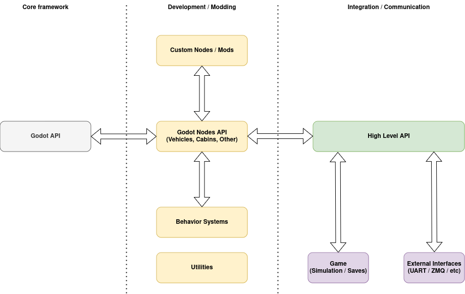

* [Overview](#overview)
* [Components, nodes and servers](#components-nodes-and-servers)
* [Talking to a vehicle](#talking-to-a-vehicle)
* [Inside a vehicle](#inside-a-vehicle)
* [Commands and method calls](#commands-and-method-calls)
* [Plugins](#plugins)

## Overview

The core is built on the Godot Engine. Godot provides rendering, sound, input, the scene system,
resources and the asset pipeline. The core adds three things on top:

* **Servers.** All high-level parts of the simulation talk to each other through servers, the
  same way Godot's own servers work. An object held by a server is addressed by an `RID`.
* **Nodes.** A node in the scene tree is only the presence of an object. It holds the object's
  handle. The implementation lives in the server.
* **Plugins.** A plugin adds what is specific to one simulation. See [Plugins](#plugins).



## Components, nodes and servers

A **high-level component** is a complete object of the simulation. It works as soon as it is
added to a scene. Examples:

* a rail vehicle
* the cabin of a vehicle
* a road vehicle
* a building or a piece of railway infrastructure, such as a signal
* the console
* the scenario system
* a UART link to external hardware

### Nodes are proxies

A high-level component is not implemented by its node. The node holds a handle (an `RID`) to an
object that a server owns. The object does the work: it simulates, keeps its configuration and
answers commands.

A vehicle shows how this works:

* `VehiclePhysicsNode` is the vehicle's node in the scene tree. It builds the vehicle, holds its
  `VehicleServer` handle and frees the vehicle when the node is freed. A plugin subclasses the node
  to build vehicles from its own data.
* The vehicle itself is a `VehicleController` with its `VehicleComponent`s. These are resources,
  not nodes. Their properties are the vehicle's configuration. `VehicleServer` holds the vehicle and
  steps it once per frame.
* Rendering, the cabin and the sounds read the vehicle's components. They do not own them.
  `RailVehicleRenderingServer` knows where the vehicle stands. Nodes of other layers, such as a cab
  interior or a sound emitter, are attached to it with `vehicle_mount_node()`.
* A vehicle does not need a node at all. When a plugin loads a scenery, it creates the vehicles
  and trainsets through the servers and keeps only their handles. A vehicle node or a `TrainSet3D`
  is only needed when you place a vehicle in a scene by hand.

## Talking to a vehicle

High-level components talk to each other only through the servers, such as `VehicleServer` and
`RailVehicleServer`.

A vehicle is controlled by **commands**. A command has a unique name. The vehicle and each of its
components register the commands they handle. `VehicleServer` delivers a command to the vehicle
with the given `RID`. You can list a vehicle's commands at runtime with `vehicle_get_commands()`.
Commands can be added and removed at runtime. A disabled component removes its commands.

### Finding a vehicle

A vehicle is identified by its `VehicleServer` handle. `RailVehicleServer` uses the same handle for
everything rail-specific: the track, the couplers and the rail components.

A vehicle also has an **id** and a **name**:

* The id is used only to find the vehicle (`vehicle_get_rid_by_id()`). It is the vehicle's name in
  the scenery, in lower case. It can be empty, and several vehicles can share it.
* The name is what the player sees (`vehicle_get_name()`).

To turn on the battery of the vehicle `train1`:

```gdscript
var vehicle: RID = VehicleServer.vehicle_get_rid_by_id("train1")
VehicleServer.vehicle_send_command(vehicle, "battery", true)
```

### Reading the state

A command runs immediately, but its effect can take time. For example, some systems need to spin
up first. To read a value, use the typed getter of the component that owns it:

```gdscript
var switches: RailVehicleSwitches = RailVehicleServer.vehicle_component_get(
        vehicle, RailVehicleComponentType.COMPONENT_SWITCHES)
var sanding: bool = switches.get_sand_active()
```

A component's properties are its configuration. Its live state is only available through getters.

`VehicleServer.vehicle_dump_state(vehicle)` returns everything the vehicle publishes in one
`Dictionary`. It is built at most once per simulation step. Use it in a console, a test or a
diagnostic tool. Do not use it to read a value every frame.

### The cabin

The cabin is a separate layer. `CabinSystem` receives what the player does with the cab controls
and turns it into vehicle commands.

## Inside a vehicle

A high-level component is usually made of many smaller parts. Communication between these parts is
private and should be as fast and simple as possible. The parts may call each other's methods,
read properties and use signals directly.

In a vehicle, a component reaches its vehicle with `get_controller()`, and the other components
through the controller.

### Adding a part from a script

A script can add its own part to a vehicle with `GenericVehicleComponentNode`. Place the node under
the vehicle's `VehiclePhysicsNode`. The node adds a `GenericVehicleComponent` to the vehicle, and
the component calls the script:

```gdscript
extends GenericVehicleComponentNode

var locked: bool = false

func _ready():
    register_command("lock_power", self._on_lock_power)

func _on_lock_power(p1, _p2):
    locked = true if p1 else false

func _process_component(delta):
    var controller: RailVehicleController = get_controller()
    if not locked and controller.get_power24_available():
        operate_something()

func operate_something():
    # some logic here
    pass
```

`demo/examples/powered_train_part.gd` is a complete example.

Other parts of the same vehicle can call the script's methods directly. Everything outside the
vehicle uses the command:

```gdscript
VehicleServer.vehicle_send_command(vehicle_rid, "lock_power", true)
```

This hides the vehicle's internal structure and gives other components a stable interface.

## Commands and method calls

Every command is a method of the vehicle's controller or of one of its components. The method is
registered under the command's name in `_register_commands()`. So there are two ways to do the same
thing, and they behave differently:

| | `VehicleServer.vehicle_send_command(vehicle, "name", ...)` | `controller.method()` |
|---|---|---|
| You need | the vehicle's `RID` | the controller or component object and its class |
| The method runs | yes | yes |
| State dump | updated immediately | out of date until the next simulation step |
| Others are notified | yes, through `VehicleServer.vehicle_command_received` | no |
| Unknown name | reported as an error, the return value says whether it was handled | parse or compile error |

The cab (`CabinSystem.vehicle_command_received`) and the scenario scripts
(`reloaded.vehicle.on_command_received`) follow a vehicle's commands through that signal.

Which one to use depends on who acts:

* **From outside the vehicle**, use a command. This applies to servers, the cab, the player, the
  AI, scripts, the console and tests. A C++ server that holds the controller still sends commands.
  For example, `RailVehicleServer.person_change_cabin()` uses the commands `cab_deactivation_auto`,
  `cab_controls_reset`, `cab_activation_auto`, `cabin_leave` and `cabin_enter`.
* **Inside the vehicle**, call the method directly. This applies to a component acting on another
  component of the same vehicle, and to the controller acting on its components.
* **Reading** a value is always a call to a typed getter. It changes nothing.
* **State set by the owner** is a C++ call, not a command. For example,
  `RailVehicleController::set_driver_cabin_kind()` is called only by `RailVehicleServer`.

If another layer needs to start an operation, the operation is registered as a command, even if
only one server uses it. The full rule is in `CODE_STYLE.md`, "A vehicle is commanded, not called".

## Plugins

A plugin adds everything that is specific to one simulation: vehicles and their physics, file
formats, sceneries, cabins and rendering. A plugin is a separate repository. Its C++ code is
compiled into the core's library, and its addon is installed next to `addons/libreloaded`.

The core knows nothing about any plugin. Instead, it offers **extension points**. An extension
point is a base class that the plugin derives from, plus a place to register the plugin's class.
A plugin uses only these extension points and the core's public API and signals.

### Building a plugin into the library

A plugin is a directory with a `plugin.cmake` file. You pass the directory to the build in
`LIBRELOADED_PLUGINS`. The `plugin.cmake` file:

* adds the plugin's sources and `doc_classes` to the library
* links the plugin's addon into the Godot project, with `reloaded_link_addon()`
* names the plugin's main class, with `reloaded_plugin()`

The main class derives from `ReloadedPlugin`. `ReloadedPluginServer` creates every plugin and
calls these methods in order:

1. `register_classes()` is called after all core classes are registered. The plugin registers its
   own classes here. It can also set things that only one plugin can provide:
   * the default vehicle controller, with `VehiclePhysicsNode::set_controller_implementation()`
   * the resolver of data paths, with `ReloadedPluginServer::data_path_set_resolver()`
   * handle kinds, signals and Lua modules for scenario scripts (see below)
2. `create_servers()` is called after the core has created its data, streaming, simulation,
   vehicle, signalling, scenario event and rendering servers. The plugin creates its own servers
   here and registers them at the extension points below.
3. `free_servers()` is called at shutdown, before the core frees its rendering servers. The plugin
   frees its servers in reverse order.

The plugin's addon registers its GDScript side itself: autoloads, custom types, importers and
project settings. The core's `addons/libreloaded/libreloaded.gd` does the same for the core.

### Registering by name

The extension points use three words:

* an **implementation** simulates something (vehicles, an AI driver)
* a **provider** supplies data or content (vehicles to choose from, sceneries)
* a **backend** draws something (models, tracks, traction)

A server that takes them by name has the same four methods for each:

| Method | What it does |
|---|---|
| `<kind>_register(name, ...)` | registers the plugin's object under `name` |
| `<kind>_unregister(name)` | removes it |
| `<kind>_get(name)` | returns it, or nothing |
| `<kind>_get_list()` | returns the registered names |

`<kind>` is `implementation`, `provider` or `backend`. A `RefCounted` object is passed as itself.
Any other object, such as a node or a server, is passed by its ObjectID (`get_instance_id()`).

Streaming providers are not registered by name: many of them work at the same time, one per loaded
world. `SceneryStreamingServer.provider_register()` returns an `RID`, and `provider_free()` removes
the provider.

### Vehicles

| Extension point | What the plugin provides | How it is registered |
|---|---|---|
| Vehicle implementation | a `VehicleImplementationServer` that steps all its vehicles in `stepping_advance()` | `VehicleServer.implementation_register()` |
| Controller and components | subclasses of `VehicleController`, `RailVehicleController` and the `RailVehicle*` component interfaces | the controller adds its components with `add_component()` |
| Engine parts | subclasses of `RailVehicleDriveUnit`, `RailVehicleCircuitUnit`, `RailVehicleTractionMotorsUnit`, `RailVehicleDieselEngineUnit` | used by the plugin's components |
| Vehicle node | a subclass of `VehiclePhysicsNode` that overrides `_build_controller()` | none |
| Appearance | a subclass of `RailVehicleAppearance` | `RailVehicleRenderingServer.vehicle_set_appearance()` |
| Vehicle catalogue | a `VehicleCatalogProvider` autoload with the vehicles and liveries a player can choose | `VehicleCatalogServer.provider_register()` |
| AI driver | a `DriverImplementation` | `DriverServer.implementation_register()` |

A vehicle's controller chooses its implementation by name (`VehicleController::set_implementation()`).
A vehicle's `VehicleData.vehicle_provider` chooses its catalogue provider. If it is empty, the
project setting `reloaded/vehicles/provider` is used.

### Sceneries and the world

| Extension point | What the plugin provides | How it is registered |
|---|---|---|
| Scenery provider | a `SceneryProvider` autoload that lists, compiles and loads sceneries and runs their scenarios | `SceneryServer.provider_register()` |
| Streaming provider | a `SceneryStreamingProvider` that loads the content of a map cell on demand | `SceneryStreamingServer.provider_register()` |
| Streaming consumer | a consumer for a content kind the core does not handle (for example terrain) | `SceneryStreamingServer.content_set_consumer()` |
| Signalling | a `SignallingImplementation` that decides what the signals show | `SignallingServer.system_attach_implementation()` |
| Scenario events | a `ScenarioEventImplementation`, plus `ScenarioEventAction` and `ScenarioEventCondition` subclasses | `ScenarioEventServer.system_attach_implementation()`, `event_attach_action()`, `event_attach_condition()` |
| Scenario scripts | handle kinds, signals and Lua modules, registered in `register_classes()` | `ScenarioScriptServer::handle_kind_register()`, `signal_register()`, `LuaModules::opener_register()` |

The nodes a scenery provider creates derive from `SceneryContentNode`. The core has its own
provider for divided worlds (`WorldSceneryProvider` with `World`) and its own streaming provider
(`WorldSectionProvider`). A plugin can extend them.

The script runtime is always Lua. A script controls a cab through a
`ScenarioScriptCabinImplementation`. The core's own, `CabinScriptImplementation`, works through
`CabinSystem`.

### Rendering

A rendering backend draws one kind of data. The plugin registers it under a name. Which backend
draws a piece of data is chosen by the data's `rendering_backend` property. If the property is
empty, the project setting is used.

| Backend | What the plugin provides | How it is registered | Chosen by |
|---|---|---|---|
| Models | a `ModelRenderingBackend` that loads models and draws their instances | `ModelRenderingServer.backend_register()` | `ModelData.rendering_backend`, or the setting `reloaded/models/backend` |
| Tracks | a `TrackRenderingBackend` that builds the meshes of tracks | `TrackRenderingServer.backend_register()` | `TrackData.rendering_backend`, or the setting `reloaded/tracks/backend` |
| Traction | a `TractionRenderingBackend` that builds the meshes of the overhead line | `TractionRenderingServer.backend_register()` | `TractionData.rendering_backend`, or the setting `reloaded/traction/backend` |

Materials are not a backend. A plugin sets one provider of materials and texture sizes with
`ReloadedMaterialServer.material_set_provider()`.

The core has its own backends: `SceneModelRenderingBackend` for models, `standard` for tracks and
`plain` for traction. A backend must unregister itself before it is freed.

Smaller hooks: `ReloadedModel3D._normalize_lights_state()`, a `LazyAudioStream` subclass for the
plugin's sound files, and a `RailVehicle3D` subclass.

### Replacing a core server

Some core servers can be replaced as a whole. The plugin's server derives from the core's server.
The plugin creates it in `create_servers()` and registers it as an engine singleton under the core
server's name. The core then does not create its own.

* **`RailVehicleRenderingServer`**: the plugin overrides its protected hooks, such as
  `_vehicle_attached`, `_vehicle_models_created`, `_vehicle_pose` and `_frame_processed`.
* **`TractionServer`**: the plugin overrides how the network is built and what each wire carries,
  such as `network_build()`, `wire_get_voltage()` and `wire_draw_current()`.

### The cab

* **Cab logic.** A `CabinLogic` is attached to a vehicle with
  `CabinSystem.vehicle_attach_cab_logic()`. Each vehicle has one. The cab's scene, a `Cabin3D`, is
  set with `vehicle_set_cabin_scene()`.
* **Per cab.** The cab logic registers computed state values
  (`CabinSystem.state_computed_value_register()`), controls (`register_control()`) and per-frame
  work (`register_process()`).

### Data and translations

* **Translations.** The plugin sets a directory of translation catalogues with
  `ReloadedTranslationServer.translation_set_catalogue_dir()`.
* **Game data.** `GameDataServer` emits `cache_clear_requested`, `data_unload_requested` and
  `data_reload_requested`. The plugin's servers react to these signals. A plugin can start a reload
  with `data_reload()`.

### Documentation of a build

The documentation always matches the library as it was built:

* The editor's help (F1) shows the classes of the core and of every plugin built into the library.
* `make docs-site` builds the documentation site for the same set: the core's pages, each
  plugin's pages under the plugin's name, and the API reference of all of them.
* `make docs` updates the `doc_classes` of each repository from the built library. Each class's
  XML file goes to the repository that declares the class.
