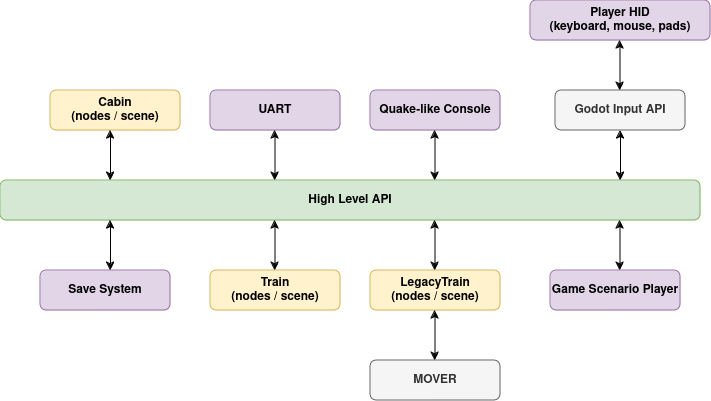

* Godot Engine as the core of the project: **Rendering**,
  **Multiplayer**, **Sound**, **Assets Pipeline**, **Utilities**,
  **Node system**, **Resources handling**, **Scene system**,
  **Input system**, **GDExtension** as programming interface
* High-Level API - servers addressed by RIDs - for communication between all high-level components and external
  systems
* Godot nodes as the *presence* of a component in the scene tree: a thin proxy that owns a handle, not the
  implementation


### Diagrams

#### Overall architecture


#### Communication example diagram

A conceptual picture: "LegacyTrain" stands for a vehicle simulated by a plugin's implementation
(see [Plugins](#plugins)).



### High-Level Components

High-Level Components should be identified as a complete and standalone
objects in the game, which encapsulates it's behavior and rendering.
They should work just by adding them to the scene.

Examples of High-Level Components in the game:
- train vehicle
- complete cabin for a vehicle
- car
- building or element of the railway infrastructure (i.e. semaphore)
- Quake-like Console
- game's scenario system
- UART communication system

#### Nodes are proxies, servers hold the implementation

A High-Level Component is not implemented by its nodes. The node standing in the scene is a proxy: it owns a handle
(an `RID`) to an object held by a server and builds that object, and the object is what simulates, configures and
answers commands. A vehicle is the reference case:

* `VehiclePhysicsNode` is the vehicle's presence in the tree. It builds the vehicle from a copy of its description (a
  `VehicleController` with its components, supplied by a plugin's subclass of the node from the plugin's data), owns
  its `VehicleServer` handle and frees both with itself.
* The vehicle - a `VehicleController` and the `VehicleComponent`s it is made of - is a `Resource`, not a node: its
  properties are its stored configuration. It is held through `VehicleServer`, stepped by its implementation once per
  rendered frame, and reached by its RID.
* What draws the vehicle (`RailVehicleRenderingServer`), its cabin and its sounds read the vehicle's components; they
  do not own them. The rendering server holds where the vehicle stands; a node of another layer - a cab interior, a
  sound emitter, the node of a vehicle assembled by hand - rides on it (`vehicle_mount_node()`).
* A vehicle needs no node at all. A scenery a plugin loads builds its vehicles and trainsets through the servers and
  holds them by their handles: the plugin makes a vehicle from its data, `RailVehicleServer.trainset_*` stands a
  trainset on its track and couples it. A plugin's vehicle node and `TrainSet3D` are for a vehicle or a trainset
  placed by hand in a scene - proxies over the same operations.

#### Communication between game objects

The communication between High-Level Components (a game objects) **must be**
implemented through **High-Level API** like **RailVehicleServer**.

The communication is based on commands identified by unique string names. A vehicle and each of its components
register the commands they answer to on the vehicle itself; `RailVehicleServer` dispatches a command to the vehicle a
RID names. Every vehicle handles its own subset of all commands, which can be inspected at runtime
(`vehicle_get_commands`). Adding and removing commands is also possible at runtime, because commands are dynamic - a
disabled component gives its commands back.

A vehicle is addressed by its `VehicleServer` handle (RID); `RailVehicleServer` knows the same handle for what is rail
(the track, the couplers, the rail component kinds). One known only by its id - its scenery name in lower case, which
may be empty or shared by several vehicles - is found first. The id is not what the player reads: that is its name as
the scenery writes it (`vehicle_get_name()`). For example, to enable battery in the `train1` vehicle:
```gdscript
var vehicle: RID = VehicleServer.vehicle_get_rid_by_id("train1")
VehicleServer.vehicle_send_command(vehicle, "battery", true)
```

A command runs on the vehicle immediately, but its effect may take time (i.e. some systems must spin up). To see
where the vehicle is, read the component that owns the value - a typed getter, read straight from the simulation
(a component's properties are its stored configuration, never its live state):

```gdscript
var switches: RailVehicleSwitches = RailVehicleServer.vehicle_component_get(
        vehicle, RailVehicleComponentType.COMPONENT_SWITCHES)
var sanding: bool = switches.get_sand_active()
```

`VehicleServer.vehicle_dump_state(vehicle)` returns everything the vehicle publishes in one `Dictionary`. It is
built at most once per step and is meant for a console, a test or a diagnostic - not for a reader that wants one
value every frame.

The cabin is a layer of its own: `CabinSystem` (the counterpart of the original engine's `TTrain`) receives what the
player does with cab controls and turns it into vehicle commands through `RailVehicleServer`.


#### Internal communication

High-Level Components are usually built from many sub-components, which will
handle a subset of a logic or rendering. The communication between these
components is private, should be fastest as possible and
straightforward. Because HLC (High-Level Component) know it's internal
structure, it can communicate with subcomponents using direct method
calls, accessing properties, signals.

Inside a vehicle that means typed calls on its components: a component reaches the vehicle it belongs to with
`get_controller()` and the other components through it, the way the wrapper's own components do.

A script adds its own part to a vehicle through a second proxy, `GenericVehicleComponentNode`, placed under the
vehicle's `VehiclePhysicsNode`. The node puts a `GenericVehicleComponent` into the vehicle, and the component calls
back into the script:

```gdscript
extends GenericVehicleComponentNode

var locked: bool = false

func _ready():
    register_command("lock_power", self._on_lock_power)

func _on_lock_power(p1, _p2):
    locked = true if p1 else false

func _process_component(delta):
    var controller: RailVehicleController = get_controller()
    if not locked and controller.get_power24_available():
        operate_something()

func operate_something():
    # some logic here
    pass
```

`demo/examples/powered_train_part.gd` is a complete example. What the script declares, other parts of the same
vehicle can call directly. Any other game object (HLC) goes through the **High-Level API**:

```gdscript
VehicleServer.vehicle_send_command(vehicle_rid, "lock_power", true)
```

This approach hides internal structure of the vehicle and creates a
stable interface between game components.

#### Commands and method calls

Every command is a method of the vehicle's controller or of one of its components, registered under a name
(`_register_commands()`). The same action can therefore be done two ways, and they are not the same:

| | `VehicleServer.vehicle_send_command(vehicle, "name", p1, p2)` | `controller.method()` / `component.method()` |
|---|---|---|
| What it needs | the vehicle's handle (RID) | the controller or the component itself, and its class |
| The method runs | yes - `VehicleController::send_command()` calls it with as many arguments as it takes | yes |
| The state dump | renewed: the controller's state serial goes up and the state is updated (`command_executed()`) | **stale** until the next simulation step - `vehicle_dump_state()` is cached on that serial |
| Who learns of it | everyone following the vehicle: `command_received`, relayed as `VehicleServer.vehicle_command_received` - the cab (`CabinSystem.vehicle_command_received`), the scenario scripts (`reloaded.vehicle.on_command_received`) | nobody |
| An unknown name | reported (`Unknown command`), the return value says whether the command was taken | a compile or a parse error |

So the choice follows from who acts:

* **Outside the vehicle** - a server, the cab, the player, the AI, a script, the console, a test - an action on the
  vehicle is a **command**. A server in C++ that holds the controller still sends the command:
  `RailVehicleServer.person_change_cabin()` switches the cab off and on with `cab_deactivation_auto`,
  `cab_controls_reset`, `cab_activation_auto`, `cabin_leave` and `cabin_enter`, never with the controller's methods.
* **Inside the vehicle's own composition** - a component acting on another component of the same vehicle, the
  controller on its components - a **direct call** (the "Internal communication" above).
* **A read** is a call of a typed getter from anywhere (`vehicle_component_get()`, see above); it changes nothing.
* **State handed down by its owner**, which the vehicle only takes and nobody else may decide, is a C++-only call and
  no command: `RailVehicleController::set_driver_cabin_kind()` is called by `RailVehicleServer` alone.

An operation another layer has to start is registered as a command and bound, even when one server alone sends it.
The rule and its reasons are in `CODE_STYLE.md` ("A vehicle is commanded, not called"); what it cost when broken is in
the [findings archive](findings-archive.html) (2026-10-05, the cab change in `RailVehicleServer`).

### Plugins

What a simulation brings of its own - its vehicles and their physics, its data formats, its sceneries, cabs and
drawing - is a plugin of the core: a repository of its own whose C++ is compiled into this library and whose addon
stands beside `addons/libreloaded`. The core knows nothing of any plugin. It offers **extension points** - a base
class to derive from and a place to register it - and a plugin reaches the core only through them, its public API
and its signals. Each point below says what the core gives, what the plugin implements, and who owns what.

#### Getting into the library

* **The build.** A plugin is a directory with a `plugin.cmake`, given by `LIBRELOADED_PLUGINS`; `CMakeLists.txt`
  includes it. It adds the plugin's sources and `doc_classes` to the library, links its addon into the project
  (`reloaded_link_addon()`) and names its plugin class (`reloaded_plugin()`), which the generated
  `ReloadedPluginServer::_create_plugins()` creates.
* **`ReloadedPlugin`** - the plugin's class; `ReloadedPluginServer` creates and holds every plugin and runs its stages
  (`register_types.cpp`):
  * `register_classes()` - once every core class is registered, since the plugin's derive from them. What the core
    leaves to one plugin for the whole process is set here: the default vehicle controller
    (`VehiclePhysicsNode::set_controller_implementation()`, a single slot - the last call wins), the resolver of the
    data's paths (`ReloadedPluginServer::data_path_set_resolver()`, one slot, read by the Lua file loader), the
    scenario scripts' handle kinds, signals and Lua modules (below).
  * `create_servers()` - after the core's data, streaming, simulation, vehicle, signalling, scenario event and
    rendering servers exist and before the servers that may be the plugin's (`TractionServer`,
    `RailVehicleRenderingServer`), the drivers, the station, the player and the scripts. The plugin creates its
    servers and registers them at the points below.
  * `free_servers()` - in reverse, before the rendering servers go.
* **The addon** registers its GDScript side itself, as `addons/libreloaded/libreloaded.gd` does the core's: its
  autoloads (providers among them), custom types, importers and settings.

#### Vehicles

* **Vehicle implementation** - what simulates vehicles. A `VehicleImplementationServer` (one virtual,
  `stepping_advance()`: one frame of all its vehicles, in phases and sub-steps of its own) registered with
  `VehicleServer.implementation_register()` under a name; the server keeps its `ObjectID`, not the object. A
  vehicle's controller names it (`VehicleController::set_implementation()`), `VehicleServer` steps each
  implementation's vehicles together on the simulation's clock, and the controller attaches to it
  (`_attach_implementation()`), which notifies its components (`VehicleComponent::_implementation_changed()`).
* **Controller and components** - the plugin's subclasses of `VehicleController` / `RailVehicleController` and of the
  `RailVehicle<X>` component interfaces, implementing their virtuals; parts of an engine are the C++ units
  (`RailVehicleDriveUnit`, `RailVehicleCircuitUnit`, `RailVehicleTractionMotorsUnit`, `RailVehicleDieselEngineUnit`).
  No registry: the controller adds its components (`add_component()`) and readers find them by
  `VehicleComponentType`.
* **The vehicle's node** - `VehiclePhysicsNode` builds a vehicle from the controller its subclass or script returns
  (`_build_controller()`), or instantiates the default controller class.
* **Appearance** - a subclass of `RailVehicleAppearance` with what the plugin's renderer animates, handed to
  `RailVehicleRenderingServer.vehicle_set_appearance()`.
* **Vehicle catalogue** - a `VehicleCatalogProvider` autoload registered with
  `VehicleCatalogServer.provider_register()`: the vehicles and liveries a player picks, their side views,
  descriptions and appearances, and `vehicle_create()`. A vehicle's `VehicleData.vehicle_provider` chooses it, else
  the setting `reloaded/vehicles/provider`.
* **Driver** - a `DriverImplementation` registered with `DriverServer.implementation_register()` under a name; the
  server holds it and attaches it to the drivers that name it (`driver_attach_implementation()`, given by
  `SceneryServer.instantiate_trainsets()`).

#### Sceneries and the world

* **Scenery provider** - a `SceneryProvider` autoload registered with `SceneryServer.register_provider()`: it lists
  its sceneries (`scenery_list()` joins every provider's), describes, compiles and instantiates them (content after
  the core's tracks, traction and power, then the vehicles) and runs their scenarios. The provider's own nodes derive
  from `SceneryContentNode` and hand it what they made to own (`content_own()`). The core's own provider of divided
  worlds, `WorldSceneryProvider` with `World`, is one a plugin may extend.
* **Streaming provider** - a `SceneryStreamingProvider` registered with `SceneryStreamingServer.provider_register()`,
  which holds it until `provider_free()`: its cells and what each chunk loads, on the streaming worker
  (`ContentKind`: terrain, models, sounds, lines, meshes). The core's own is `WorldSectionProvider`.
* **Streaming consumer** - `SceneryStreamingServer.content_set_consumer()` for a content kind no core server takes
  (the core takes models, lines, meshes and sounds; terrain is left to a plugin), and streaming owners of its own
  (`owner_create()`, `stream_register()`).
* **Signalling** - a `SignallingImplementation` attached to a signalling system
  (`SignallingServer.system_attach_implementation()`, or `SignallingSystemNode.implementation`): how its signal heads
  answer events and routes; the server holds it per system.
* **Scenario events** - a `ScenarioEventImplementation` attached to an event system
  (`ScenarioEventServer.system_attach_implementation()`): when an event may be queued and runs; and the plugin's
  `ScenarioEventAction`s and `ScenarioEventCondition`s attached to its events (`event_attach_action()`,
  `event_attach_condition()`).
* **Scenario scripts** - from `register_classes()`, before any script runs: handle kinds
  (`ScenarioScriptServer::handle_kind_register()`), signals (`signal_register()`, delivered with `script_deliver()`)
  and Lua modules (`LuaModules::opener_register()`, opened in every script's state). The runtime itself is Lua and not
  replaceable. A script's cab is a `ScenarioScriptCabinImplementation` attached to its context
  (`context_attach_cabin_implementation()`); the core's own, `CabinScriptImplementation`, acts through `CabinSystem`.

#### Drawing

* **Model backend** - a `ModelRenderingBackend` registered with `ModelRenderingServer.backend_register()`: loading a
  model, its instances, their parts, lights, signal heads and overlays; it emits `instance_created/built/freed`. A
  model's `ModelData.model_provider` chooses it, else the setting `reloaded/models/backend`; streamed models are handed
  to it. The core's own is `SceneModelRenderingBackend`. The server does not own a backend, which unregisters before
  it goes.
* **Track backend** - a `TrackRenderingBackend` registered with `TrackRenderingServer.backend_register()`: a track's
  description, streaming and building. A track chooses it (`TrackData::get_rendering_backend()`, a plugin's
  `TrackData` subclass), else the setting `reloaded/tracks/backend`; the core's own is the `standard` one. A backend
  unregisters before it goes, and its tracks are freed with it.
* **Traction backend** - a `TractionRenderingBackend` registered with
  `TractionRenderingServer.register_rendering_backend()`, chosen by the setting `reloaded/traction/backend`; the
  core's own is `plain`.
* **Materials** - one provider of materials and texture sizes, `ReloadedMaterialServer.material_set_provider()`;
  without it `material_get()` returns nothing.
* **Smaller hooks** - `ReloadedModel3D._normalize_lights_state()`, a `LazyAudioStream` subclass for the plugin's
  sound data, a `RailVehicle3D` subclass.

#### A core server computed the plugin's way

Where the core has a whole server and a plugin computes it otherwise, the plugin's server derives from the core's and
takes its place: it is created in `create_servers()` and registered as the engine singleton under the core's name,
and the core creates its own only when none is there - and frees only its own.

* **`RailVehicleRenderingServer`** - the plugin overrides its protected hooks (`_vehicle_attached`,
  `_vehicle_models_created`, `_vehicle_pose`, `_frame_processed`, ...); C++ reaches it through `get_instance()`, set by
  the base constructor, scripts by the singleton's name.
* **`TractionServer`** - the plugin overrides how the network is built and what a wire carries (`network_build()`,
  `wire_get_voltage()`, `wire_draw_current()`, ...); C++ and scripts reach it by the singleton's name.

#### The cab

* **Cab logic** - a `CabinLogic` attached to a vehicle (`CabinSystem.vehicle_attach_cab_logic()`, one per vehicle,
  registered again when the driver changes cabin, dropped when the vehicle is freed) and the scene of its cab
  (`vehicle_set_cabin_scene()`, a `Cabin3D`).
* **Per cab** - computed state values (`CabinSystem.state_computed_value_register()`), controls
  (`register_control()`) and per-frame work (`register_process()`), registered by the cab logic and unregistered with
  it.

#### Data and translations

* **Translations** - a catalogue directory of the plugin's data (`ReloadedTranslationServer.translation_set_catalogue_dir()`).
* **Game data** - `GameDataServer` has no registration: it announces `cache_clear_requested`,
  `data_unload_requested` and `data_reload_requested`, and the plugin's servers follow them; a plugin starts a reload
  with `data_reload()`.

#### The documentation of a build

A build of the library is the core and the plugins it is built with, and so is its documentation: the editor shows
under F1 the class reference of the core and of every plugin built in (CMake gathers their `doc_classes` into
`DOC_XML`), and `make docs-site` assembles the site of the same set - the core's guides, each plugin's under its
name, the class reference of all of them. Each repository keeps only its own: `make docs` refreshes every source's
`doc_classes` from the library and hands each class's XML to the repository declaring it.
