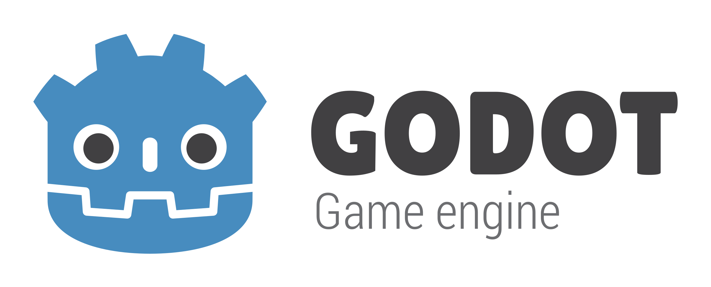
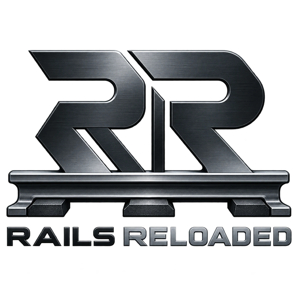

## Rails Reloaded Core

Rails Reloaded Core (libreloaded) is the foundation for railway simulations built with the Godot
Engine. It is a C++ GDExtension with a GDScript addon.

The core contains the parts that every railway simulation needs:

* servers for vehicles, cabins, the player and cameras
* tracks, traction and signalling
* sceneries, scenarios and Lua scripts
* rendering of tracks, roads, traction and other scenery elements
* custom Godot nodes for building vehicles, cabins and sceneries

Everything specific to one simulation is added by a **plugin**. This includes its vehicles and
their physics, its file formats, its sceneries and its cabins. A plugin is compiled into the same
library as the core. See [Plugins](architecture#plugins) for how this works.

An example of a plugin is [libmaszyna](https://github.com/MaSzyna-Reloaded/libmaszyna), a port of
[MaSzyna - Symulator Pojazdów Szynowych](https://eu07.pl).

## Documentation

* [Architecture](architecture) - how the core is built and how plugins extend it
* [API reference](api/) - all classes of the core and of the plugins this site was built with
* [Lua scenario scripts](lua-scripting) - the scripting API for sceneries

## Godot resources

* [GDExtension documentation](https://docs.godotengine.org/en/stable/tutorials/scripting/gdextension/index.html)
* [Making plugins for Godot](https://docs.godotengine.org/en/stable/tutorials/plugins/editor/making_plugins.html)
* [Why Godot is not an ECS-based engine](https://godotengine.org/article/why-isnt-godot-ecs-based-game-engine/)
* [Not everything must be a Node](https://docs.godotengine.org/en/stable/tutorials/best_practices/node_alternatives.html)
* [Multiplayer API](https://docs.godotengine.org/en/stable/tutorials/networking/high_level_multiplayer.html)
* [Input handling](https://docs.godotengine.org/en/stable/tutorials/inputs/index.html)
* [Assets pipeline](https://docs.godotengine.org/en/stable/tutorials/assets_pipeline/index.html)
* [Materials](https://docs.godotengine.org/en/stable/tutorials/3d/standard_material_3d.html)
* [Performance and optimization](https://docs.godotengine.org/en/stable/tutorials/performance/index.html)

## Goals

* **A modern engine.** Godot gives us good rendering, performance and tools.
* **Open development.** The code is open source and contributions are welcome.
* **Modding.** Players and developers can customize and extend the simulation.

## Authors

- **[Marcin Nowak](https://github.com/marcinn/)**: software architecture and programming
- **[Karol "DoS" Tomaszewski](https://github.com/JezSonic)**: game port concept, CI and programming
